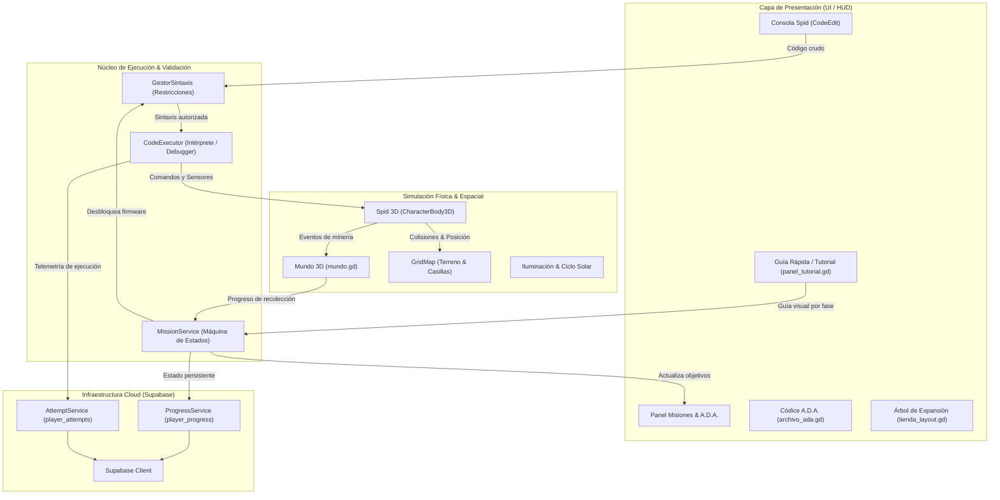

# 🚀 SpidoCode — Documento Maestro de Proyecto e Hitos

> **Versión del Documento:** 1.1.0  
> **Última Actualización:** 26 de Octubre de 2026  
> **Estado General del Proyecto:** En Desarrollo Activo (Fases 1 a 8.5 Estructuradas en Misiones, Fase 0 Implementada)  
> **Propósito:** Registro centralizado del estado del sistema, arquitectura, currículo pedagógico para Duoc UC, control de versiones y seguimiento continuo de hitos para el equipo de desarrollo.

---

## 1. Visión y Propósito del Proyecto

**SpidoCode** es un videojuego serio (*serious game*) en 3D desarrollado sobre **Godot Engine 4.7.1** concebido para la enseñanza interactiva de **Fundamentos de Programación, Algoritmos y Programación Orientada a Objetos** con **Python** en carreras de tecnología (Duoc UC).

A través del control cinemático de un rover explorador (**Spid**) en un entorno espacial/asteroide y la guía de una inteligencia artificial de a bordo (**A.D.A.**), el estudiante aprende la lógica computacional de **Python** escribiendo código real en una consola integrada (IDE). Cada línea se traduce en acciones físicas inmediatas (movimiento, minería, sensores y transferencia de carga), consolidando el aprendizaje mediante retroalimentación visual en tiempo real.

```
       ┌────────────────────────────────────────────────────────┐
       │                 BUCLE CENTRAL DE JUEGO                 │
       └────────────────────────────────────────────────────────┘
          Escribir Código en Consola (Sintaxis Python real)
                                │
                                ▼
          Compilación & Ejecución Segura (AST / CodeExecutor)
                                │
                                ▼
          Acciones Físicas en Asteroide 3D (Spid / Sensores)
                                │
                                ▼
          Minería de Yacimientos y Transferencia a la Nave
                                │
                                ▼
          Desbloqueo Orgánico de Sintaxis y Expansión de Mapa
                                │
                                ▼
          Nuevas Misiones Pedagógicas y Desafíos de A.D.A.
```

---

## 2. Arquitectura Global del Sistema

El proyecto opera bajo un modelo desacoplado y orientado a servicios mediante **Singletons (Autoloads)** en Godot y persistencia en la nube:



---

## 3. Matriz de Progresión Curricular (Fases 0 a 8.5)

| Fase | Concepto Didáctico | Expansión del Terreno | Misiones Clave | Estado |
| :---: | :--- | :--- | :--- | :---: |
| **0** | **Inducción y Primer Contacto** | Base 1x1 | • Modal de Guía Rápida (`panel_tutorial.gd`)<br>• Tarjetas de Consola, Movimiento y Ciclo | **100% OK** |
| **1** | **Secuencia Lineal** | 1x1 $\rightarrow$ Corredor 1x3 | • `recolectar_primer_mineral`<br>• `ruta_calibracion` | **100% OK** |
| **2** | **Bucle `while`** | Corredor 1x3 | • `trabajo_continuo`<br>• `cuota_suministro` | **100% OK** |
| **3** | **Condicionales `if / else`** | Sector 2x3 (6 casillas) | • `senales_inciertas`<br>• `comprar_mapa_3x3` | **100% OK** |
| **4** | **Bucle `for in range()`** | Sector 2x3 | • `ciclo_recoleccion`<br>• `patrulla_autonoma` (anidado) | **100% OK** |
| **5** | **Variables y Parámetros** | Sector 3x3 (9 casillas) | • `calibracion_variables`<br>• `telemetria_dinamica` | **100% OK** |
| **6** | **Listas y Colecciones** | Sector 4x3 (12 casillas) | • `patrulla_lista`<br>• `barrido_listas_autonomo` | **100% OK** |
| **7** | **Funciones (`def`)** | Sector 4x4 $\rightarrow$ 5x4 | • `rutina_funciones`<br>• `funciones_parametrizadas` | **100% OK** |
| **8** | **Sector 5x5 y Endgame** | Sector 5x5 (25 casillas) | • `barrido_columnas`<br>• `protocolo_maestro` | **100% OK** |

---

## 4. Registro Maestro de Hitos (Milestones Tracker)

### ✅ Hitos Completados

* **HITO-01: Cimiento de Movimiento y Secuencia (Fase 1)**
  * Implementación del Spid 3D con movimientos discretos por casillas de 2 metros.
  * Comandos de minería y transferencia con cola de instrucciones y animaciones.

* **HITO-02: Automatización y Control con While (Fase 2)**
  * Validador y ejecutor para `while True:` y `while minerales_en_nave() < 10:`.
  * Expansión de mapa a Corredor 1x3 con timeout de seguridad anti-bucles infinitos.

* **HITO-03: Sensores y Toma de Decisiones If/Else (Fase 3)**
  * Expansión a Sector 2x3 con distribución pseudoaleatoria de mineral fuera de base.
  * Implementación del sensor `spid.hay_mineral()`.
  * Soporte de bloques `else:` con tolerancia a sangría en `code_executor.gd`.

* **HITO-04: Códice A.D.A. y Centralización de Comandos**
  * Creación del Códice interactivo de conocimiento espacial.
  * Pestaña prioritaria `[ COMANDOS SPID ]` desbloqueada por defecto al frente.

* **HITO-05: Referenciación Espacial e Iluminación Nocturna**
  * Resaltador holográfico verde suave en casilla base `(0, 0, 0)`.
  * Foco de iluminación tipo estadio (`SpotLight3D` + `OmniLight3D`) para iluminar a Spid de noche.

* **HITO-06: Robustecimiento de Variables y Parámetros en Rango (Fase 5)**
  * Validación y cobertura con tests automatizados en `tests/test_parametros_variables.gd`.

* **HITO-07: Protocolo de Inducción, Sistema de Tutoriales por Fase y Botón `[ GUÍA ]` (Fase 0)**
  * Creación del componente modal `PanelTutorial` (`escenas/panel_tutorial.tscn` y `script/panel_tutorial.gd`) con navegación interactiva de tarjetas e imágenes dinámicas por fase.
  * Generación de las 3 imágenes gráficas esenciales para la Fase 0 (`fase0_1_consola.png`, `fase0_2_movimiento.png`, `fase0_3_ciclo.png`) en `assets/tutorial/` con tipografía `PixelifySans`.
  * Integración del botón `[ GUÍA ]` en la barra superior `ContenedorTienda` junto a `[ MEJORAS ]` y `[ CÓDICE ]`.
  * Lanzamiento automático en el primer inicio de partida (`recolectar_primer_mineral`) para guiar al estudiante de inmediato.
  * Verificación técnica headless completada con 100% de éxito en Godot 4.7.1.
